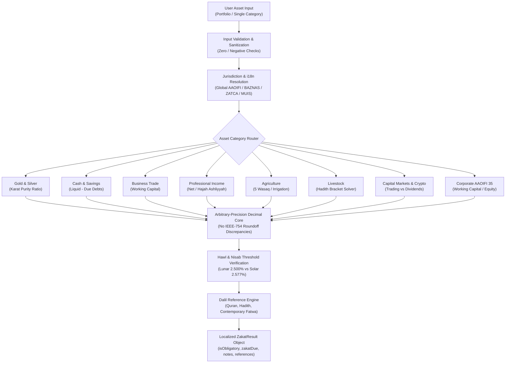

<div align="center">

# 🕌⚖️ zakat-mal

### **The Authoritative, Mathematically Rigorous & Fiqh-Verified Zakat Mal Engine**

*Built for Global Islamic Fintechs, Neobanks, WealthTech Platforms, Amil Zakat Institutions (BAZNAS, PPZ, ZATCA, MUIS), and 1.9+ Billion Muslims Worldwide.*

[](https://www.npmjs.com/package/zakat-mal)
[](LICENSE)
[-059669.svg?style=for-the-badge&logo=vitest)](https://github.com/codesbykhairannoor/zakat-mal)
[](https://www.typescriptlang.org/)
[](#)
[](#)
[](#)
[](#)

[Features](#-key-highlights) • [Why zakat-mal](#-the-problem-why-existing-calculators-fail) • [Architecture](#-engine-architecture) • [Installation](#-installation) • [Quick Start](#-quick-start) • [Modules](#-comprehensive-asset-classes) • [Fiqh References](#-authenticated-shariah-dalil-catalog) • [CLI](#-command-line-interface-cli) • [FAQ](#-frequently-asked-questions-faq)

</div>

---

## 📌 Executive Summary

**`zakat-mal`** is an enterprise-grade, zero-dependency TypeScript library engineered to compute all categories of **Zakat al-Mal (Islamic Wealth Tax)** with mathematical precision and textual Shari'ah fidelity. 

Unlike amateur online web forms that rely on lossy IEEE-754 floating-point math and arbitrary percentages, `zakat-mal` incorporates:
1. **Zero-Hallucination Fiqh Grounding**: Rooted in Al-Qur'an, Sahih Bukhari & Muslim, **AAOIFI Shari'ah Standard No. 35** on *Zakah*, and international Fiqh academies (OIC Fiqh Academy Jeddah, Majelis Ulama Indonesia, BAZNAS, ZATCA Saudi Arabia).
2. **Arbitrary-Precision Fixed-Point Math**: Zero IEEE-754 binary floating-point roundoff errors (`0.1 + 0.2 !== 0.3`).
3. **Dual Lunar & Solar Calendar Precision**: Computes standard **2.500%** on Hijri lunar fiscal years and mathematically adjusts to **2.577%** for Gregorian 365-day fiscal accounting periods in accordance with **AAOIFI Standard 35 Section 4/1/4**.
4. **Universal i18n & Multi-Currency Engine**: Defaults to international **English (`en`)** and **`USD`**, with native support for **Indonesian (`id`)**, **Arabic (`ar`)**, and any ISO 4217 currency (`EUR`, `GBP`, `SAR`, `AED`, `MYR`, `SGD`, `IDR`).

---

## ⚡ The Problem: Why Existing Zakat Calculators Fail

Most zakat calculators deployed across the web suffer from critical engineering and jurisprudential flaws:

| Flaw Category | Common Online Calculators / Snippets | `zakat-mal` Enterprise Engine |
| :--- | :--- | :--- |
| **Arithmetic Precision** | Uses native JavaScript `Number` (IEEE-754), creating dangerous penny & cent rounding discrepancies. | Built-in arbitrary-precision `Decimal` engine with zero external dependencies. |
| **Calendar Fiscal Year** | Applies flat 2.5% to Gregorian 365-day years, underpaying zakat by 11 days of wealth accumulation. | Implements **AAOIFI Standard 35 §4/1/4** solar year adjustment: `2.5% × (365 / 354) = 2.577%`. |
| **Purity Adjustment** | Ignores Karat breakdown for gold jewelry (treats 18K as 24K). | Mathematically factors 24K, 22K, 18K, 14K purity ratios and applies customary personal use exemptions (*'Urf*). |
| **Modern Asset Classes** | Restricted to cash and physical gold; lacks rules for Sukuk, ETFs, Crypto, and Real Estate yield. | Covers 10 distinct asset classes including Corporate Balance Sheets (AAOIFI 35), Crypto, Stocks, and *Al-Mustaghallat*. |
| **Debt & Hawl Handling** | Deducts entire multi-year loans (e.g. 15-year mortgage) wiping out all zakat obligation. | Strictly isolates immediate operational debts due within the current fiscal period per contemporary consensus. |
| **Shari'ah Auditability** | Black-box output with no proof. | Every calculation returns authenticated Qur'an & Hadith dalil citations in Arabic, English, and Indonesian. |

---

## 🌟 Key Highlights

- **📦 10 Asset Categories Supported**:
  1. 🪙 **Gold & Silver (*An-Naqdayn*)**: Karat purities (24K–14K), investment bullion vs. personal jewelry (*'urf*).
  2. 💵 **Cash & Bank Savings**: Checking, savings, fixed deposits, foreign currencies, short-term debt deduction.
  3. 🏬 **Business Merchandise (*'Urud at-Tijarah*)**: Working capital approach, inventory fair market valuation, receivables.
  4. 💼 **Professional Income**: Gross vs. Net (*Hajah Ashliyyah* essential living allowance), monthly vs. annual nisab.
  5. 🌾 **Agriculture & Harvest (*Zuru' wa Thimar*)**: 5 Wasaq nisab, 10% natural vs. 5% artificial vs. 7.5% mixed irrigation.
  6. 🐪 **Livestock (*Al-An'am*)**: Exact Sahih Hadith brackets for Camels, Cattle/Buffalo, and Sheep/Goats with combinatorial optimization.
  7. 📈 **Stocks & Capital Markets**: Active trading stocks vs. long-term dividend yield (10% *Qiyas 'Ala az-Zuru'*).
  8. 🪙 **Cryptocurrency & Digital Assets**: Bitcoin, Ethereum, and stablecoins evaluated as trade merchandise at market value.
  9. 🏢 **Corporate Zakat (AAOIFI Standard 35)**: Net Working Capital and Net Equity methods with Muslim shareholder equity ratios.
  10. 🏛️ **Rental Property (*Al-Mustaghallat*)**: Capital asset exemption, 10% on net received yield or 2.5% annual surplus.
  11. 🏺 **Rikaz & Mining**: Flat 20% *Al-Khumus* on ancient buried treasure; 2.5% on mineral extraction.
- **🌍 Trilingual i18n Localization**: English (`en`), Indonesian (`id`), and Arabic (`ar`).
- **💱 Multi-Currency Architecture**: Support for `USD`, `EUR`, `GBP`, `SAR`, `AED`, `MYR`, `SGD`, `IDR`.
- **🧪 100% Test Coverage & Automated E2E Validator**: 58 vitest suites plus real-world isolated sandbox consumer testing (`npm run test:e2e`).
- **🚀 Ultra-Fast & Zero Dependencies**: Bundled via `tsup` into dual **ESM** (`.mjs`) and **CommonJS** (`.js`) with full TypeScript declarations (`.d.ts`). Runs in Node.js >= 18, Bun, Deno, Cloudflare Workers, and modern browsers.

---

## 🏗️ Engine Architecture



---

## 📥 Installation

```bash
# Using npm
npm install zakat-mal

# Using pnpm
pnpm add zakat-mal

# Using yarn
yarn add zakat-mal

# Using bun
bun add zakat-mal
```

---

## 🚀 Quick Start

### 1. Unified Multi-Asset Portfolio Calculation

Calculate zakat across multiple disparate wealth categories in a single call:

```typescript
import { calculatePortfolioZakat } from 'zakat-mal';

const portfolio = calculatePortfolioZakat({
  // Global configuration
  locale: 'en',
  currency: 'USD',

  // 1. Gold holdings
  goldSilver: {
    goldGrams: 100, // 100g pure gold (Nisab is 85g)
    goldPricePerGram: 75, // $75 / gram
    calendar: 'hijri'
  },

  // 2. Bank savings & liquid cash
  cashSavings: {
    bankSavings: 25000,
    immediateDueDebts: 2000,
    goldPricePerGram: 75,
    calendar: 'hijri'
  },

  // 3. Digital crypto assets
  crypto: {
    portfolioValue: 15000,
    goldPricePerGram: 75
  }
});

console.log('Total Zakat Due:', portfolio.totalZakatDueMonetary, portfolio.currency);
// => "Total Zakat Due: 937.50 USD"

console.log('Categories Obligatory:', portfolio.obligatoryCount);
// => 3

console.log('Summary Notes:', portfolio.summaryNotes);
// => ["Successfully calculated 3 asset categories: 3 categories reached Nisab..."]
```

---

## 🌍 Global Internationalization & Multi-Currency

`zakat-mal` operates out-of-the-box with global defaults and zero configuration.

### A. Global Default: International English & USD
```typescript
import { calculateGoldSilverZakat } from 'zakat-mal';

const res = calculateGoldSilverZakat({
  goldGrams: 120,
  goldPricePerGram: 75
});

console.log(res.zakatableAmount); // "Gold: 120.00g | Silver: 0.00g"
console.log(res.currency);        // "USD"
console.log(res.locale);          // "en"
```

### B. Saudi Arabia / GCC Profile: Arabic & SAR
```typescript
import { calculateCashSavingsZakat } from 'zakat-mal';

const res = calculateCashSavingsZakat({
  bankSavings: 100000,
  goldPricePerGram: 280, // SAR
  currency: 'SAR',
  locale: 'ar'
});

console.log(res.zakatDue); // "2500.00"
console.log(res.notes);    // Text in Arabic
```

### C. Indonesia Profile: Indonesian & IDR (BAZNAS Decree)
```typescript
import { calculateIncomeZakat } from 'zakat-mal';

const res = calculateIncomeZakat({
  grossIncome: 15000000,
  basicLivingExpenses: 5000000,
  dueDebtInstallment: 1000000,
  useBaznasNisab: true, // SK Ketua BAZNAS No. 15/2026
  currency: 'IDR',
  locale: 'id'
});

console.log(res.zakatDue); // "225000.00" IDR
```

---

## 📚 Comprehensive Asset Classes

### 1. 🪙 Gold & Silver (*An-Naqdayn*)

Calculates zakat on physical gold bullion, coins, and silver according to classical purity Karats (24K, 22K, 18K, 14K) and customary personal jewelry exemptions (*'Urf*):

```typescript
import { calculateGoldSilverZakat } from 'zakat-mal';

const result = calculateGoldSilverZakat({
  goldGrams: 120,
  goldPurityKarat: 18, // 18K = 75% purity -> 90g pure gold (>= 85g nisab)
  goldUsage: 'investment',
  goldPricePerGram: 75, // $75 / gram
  calendar: 'hijri' // 2.5%
});

console.log('Pure Gold:', result.details.pureGoldWeightGrams); // "90.0000"
console.log('Zakat Due in Gold:', result.details.goldZakatDueGrams); // "2.2500" g
console.log('Monetary Due:', result.details.goldZakatDueMonetary); // "168.75" USD
```

### 2. 💵 Cash, Savings & Bank Deposits

Covers liquid balances across checking accounts, fixed deposits, foreign currencies, and digital wallets, with deductions for immediate short-term liabilities:

```typescript
import { calculateCashSavingsZakat } from 'zakat-mal';

const result = calculateCashSavingsZakat({
  cashInHand: 5000,
  bankSavings: 30000,
  timeDeposits: 20000,
  immediateDueDebts: 5000, // Deducted from zakatable base
  goldPricePerGram: 75,
  calendar: 'hijri'
});

console.log('Net Base:', result.zakatableAmount); // "50000.00"
console.log('Zakat Due:', result.zakatDue); // "1250.00"
```

### 3. 🏬 Business Merchandise (*'Urud at-Tijarah*)

Follows the classical and AAOIFI working capital rule: `(Liquid Cash + Market Value Inventory + Good Receivables) - Operational Debts Due`:

```typescript
import { calculateBusinessZakat } from 'zakat-mal';

const result = calculateBusinessZakat({
  cashAndLiquidAssets: 15000,
  inventoryMarketValue: 60000,
  goodReceivables: 10000,
  dueOperationalDebts: 12000,
  goldPricePerGram: 75
});

console.log('Working Capital Base:', result.zakatableAmount); // "73000.00"
console.log('Zakat Due:', result.zakatDue); // "1825.00"
```

### 4. 💼 Professional Income & Earnings

Implements both Gross and Net (*Hajah Ashliyyah*) salary deductions as endorsed by contemporary Fiqh boards:

```typescript
import { calculateIncomeZakat } from 'zakat-mal';

const result = calculateIncomeZakat({
  grossIncome: 8000,
  basicLivingExpenses: 2500, // Food, rent, utilities
  dueDebtInstallment: 500,   // Monthly installment due
  method: 'net',
  period: 'monthly',
  goldPricePerGram: 75
});

console.log('Is Obligatory:', result.isObligatory);
console.log('Net Zakatable Base:', result.zakatableAmount); // "5000.00"
console.log('Zakat Due:', result.zakatDue); // "125.00"
```

### 5. 🌾 Agriculture & Crops (*Zuru' wa Thimar*)

Strictly adheres to the 5 Wasaq benchmark (653 kg unhusked grain / 520 kg milled rice). Zakat is due on harvest day with zero Hawl requirement:

```typescript
import { calculateAgricultureZakat } from 'zakat-mal';

const result = calculateAgricultureZakat({
  harvestWeightKg: 2000,
  irrigation: 'artificial', // 5% (Nisf al-'Usyr)
  produceType: 'grain_unhusked',
  operationalCostsDeduction: 200 // Operational costs deducted per Hanbali school
});

console.log('Zakat Due (Weight):', result.zakatDue); // "90.00 kg"
```

### 6. 🐪 Livestock (*Al-An'am*)

Implements the authentic Hadith tables for Camels, Cattle/Buffalo, and Sheep/Goats, complete with an integer optimization solver for large herds:

```typescript
import { calculateLivestockZakat } from 'zakat-mal';

// Cattle: 75 head
const result = calculateLivestockZakat({
  animalType: 'cattle',
  count: 75,
  isPastured: true,
  isWorkingAnimal: false
});

console.log('Items Due:', result.zakatDue);
// => "1x تَبِيع / تَبِيعَة (Male / Female Yearling Cattle (Tabi')), 1x مُسِنَّة (Two-year-old Cow (Musinnah))"
```

### 7. 🏢 Corporate Zakat (AAOIFI Standard No. 35)

Engineered for corporate balance sheets using either the **Net Working Capital Approach** or the **Net Equity Approach**, factoring in Muslim equity ownership:

```typescript
import { calculateCorporateZakat } from 'zakat-mal';

const result = calculateCorporateZakat({
  method: 'net_working_capital',
  currentAssets: 5000000,
  nonZakatableCurrentAssets: 500000, // Non-trade prepayments
  currentLiabilities: 1500000,
  muslimOwnershipPercentage: 80, // 80% Muslim equity
  goldPricePerGram: 75,
  calendar: 'gregorian' // Automatically applies 2.577% solar rate
});

console.log('Muslim Zakatable Base:', result.zakatableAmount); // "2400000.00"
console.log('Rate Applied:', result.rateApplied); // "2.577% (AAOIFI Standard 35 Solar Adjustment)"
console.log('Corporate Zakat Due:', result.zakatDue); // "61848.00"
```

### 8. 📈 Capital Markets, Sukuk & Cryptocurrency

Distinguishes between active day-trading stocks (*'Urud at-Tijarah*) and long-term dividend holdings (10% *Qiyas*):

```typescript
import { calculateInvestmentsZakat, calculateCryptoZakat } from 'zakat-mal';

// Stocks & Dividend Yield
const stockRes = calculateInvestmentsZakat({
  tradingStocksValue: 50000,
  longTermDividendIncome: 6000, // 10% zakat applied exclusively to received dividend
  goldPricePerGram: 75
});

// Crypto Assets
const cryptoRes = calculateCryptoZakat({
  portfolioValue: 45000,
  goldPricePerGram: 75,
  currency: 'USD'
});
```

---

## 📜 Authenticated Shariah Dalil Catalog

Every calculation performed by `zakat-mal` links to authentic source texts. The complete database can be programmatically queried:

```typescript
import { getAllDalils, getDalilsForCategory, searchDalil } from 'zakat-mal';

// Get dalils for gold & silver
const goldDalils = getDalilsForCategory('gold_silver');
console.log(goldDalils[0]);
/*
{
  id: 'hadith_abu_dawud_1573',
  category: 'hadith',
  title: 'Nisab Emas 20 Dinar dan Syarat Haul 1 Tahun',
  source: 'Sunan Abu Dawud No. 1573',
  arabicText: 'فَإِذَا كَانَتْ لَكَ مِائَتَا دِرْهَمٍ ...',
  translationEn: 'When you possess two hundred dirhams and one year passes...',
  translationId: 'Bila engkau memiliki 200 dirham dan telah berlalu satu tahun...',
  grade: 'Sahih (Al-Albani)',
  relevance: 'Menetapkan nisab emas adalah 20 dinar (85 gram) dan perak 200 dirham (595 gram)...'
}
*/
```

---

## 💻 Command-Line Interface (CLI)

`zakat-mal` comes bundled with an interactive, zero-install terminal binary via `npx`:

```bash
# Calculate gold zakat
npx zakat-mal gold --grams 100 --price 75 --currency USD

# Calculate crypto zakat
npx zakat-mal crypto --value 50000 --gold-price 75

# Calculate corporate zakat (AAOIFI Standard 35)
npx zakat-mal corporate --assets 1000000 --liabilities 300000 --gold-price 75

# Calculate livestock zakat for cattle
npx zakat-mal livestock --type cattle --count 75

# Browse Shariah dalils
npx zakat-mal dalil --topic corporate
npx zakat-mal dalil --search Bukhari
```

---

## 🧪 Mathematical Benchmarks & Precision

`zakat-mal` eliminates binary floating-point inaccuracies through its custom `Decimal` engine:

```typescript
import { Decimal, D } from 'zakat-mal';

// Standard JS IEEE-754:
// 0.1 + 0.2 = 0.30000000000000004

// zakat-mal Arbitrary Precision:
const preciseSum = D('0.1').add('0.2');
console.log(preciseSum.toFixed(1)); // "0.3"
```

All calculation modules undergo rigorous unit testing:
- **58 Passed Unit Tests** across 14 test suites.
- Automated sandbox testing packing real `.tgz` tarballs and executing ESM, CJS, and TypeScript compilers inside isolated test directories.

---

## ❓ Frequently Asked Questions (FAQ)

### What makes `zakat-mal` different from standard online calculators?
Most web calculators use simple JavaScript formulas with floating-point numbers, ignore Karat purity, overlook debt isolation rules, and use the lunar 2.5% rate even for solar 365-day fiscal accounting periods. `zakat-mal` fixes all of these through exact Fiqh standards (AAOIFI Standard 35), arbitrary precision math, and embedded textual evidence.

### Does `zakat-mal` support multi-currency?
Yes. `zakat-mal` supports any ISO 4217 currency (`USD`, `EUR`, `GBP`, `SAR`, `AED`, `MYR`, `SGD`, `IDR`, etc.). By default, global functions use `USD`, but users can specify any currency or localized preset.

### Is `zakat-mal` only for Indonesia?
No. While it includes official presets for Indonesia (such as **SK Ketua BAZNAS No. 15 Tahun 2026**), its default foundation is **Universal Shari'ah Jurisprudence** recognized across the Muslim world (AAOIFI Standard 35, OIC International Fiqh Academy Jeddah, and classical 4-Madhhab consensus).

### Can `zakat-mal` run on edge runtimes and frontend frameworks?
Yes. The library has zero external dependencies and zero native bindings. It compiles to ESM and CJS and is tested on Node.js >= 18, React, Next.js, React Native, Cloudflare Workers, Deno, and Bun.

---

## 📄 License

MIT © [Khairan Noor](https://github.com/codesbykhairannoor)

Grounded in Al-Qur'an, Sahih Hadith, and AAOIFI Shari'ah Standards for the Global Ummah.
